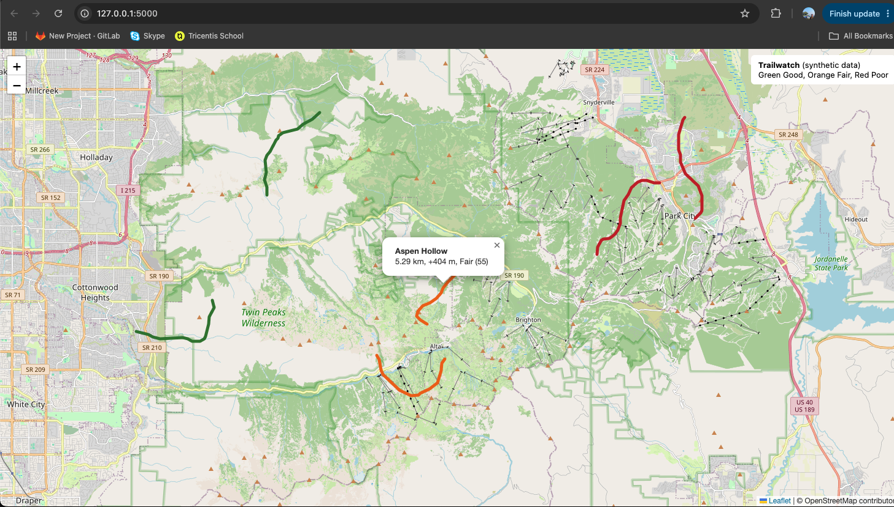

# Trailwatch




A small outdoor conditions data pipeline with geospatial processing, a rule based conditions score, a REST API and a map.

**All data is synthetic.** Trails, weather stations and daily readings are generated by `trailwatch/generate_data.py`. Nothing here is real conditions data, and the score is not a safety or avalanche tool.

The generated window is the 30 days ending on the day you run it, so the committed CSVs age like any other checked-in sample. Re-run the generator to refresh them; the API reports how old each reading is either way.


## What it does

1. **Ingest and validate** (`pipeline.py`): loads trails, GPS points, stations and daily readings from CSV. Bad rows are rejected with a reason (missing value, out of range, duplicate, unknown station, date in the future) and stored in a `rejected_readings` table. Files are read as `utf-8-sig`, so a CSV saved from Excel loads despite its byte order mark, and headers are checked before anything is written: a missing column is reported with the header that was found, and the previous database is left untouched. The summary also names trails whose station is missing (`trails_without_a_station`) and trails with fewer than two points (`trails_without_a_line`).
2. **Geospatial processing** (`geo.py`): haversine distance, trail length, and elevation gain with a noise threshold for GPS elevation wiggle.
3. **Conditions score** (`scoring.py`): wind, temperature, precipitation and recent snow accumulation produce a 0-100 score and a Good, Fair or Poor rating with reasons.
4. **API and map** (`api.py`): Flask endpoints plus a Leaflet map that colors each trail by rating.

## Run it

```
python3 -m venv .venv && source .venv/bin/activate   # Python 3.11 or newer
pip install -r requirements-dev.txt
python -m trailwatch.generate_data data
python -m trailwatch.pipeline data trailwatch.db
python -m trailwatch.api trailwatch.db
```

Open http://127.0.0.1:5000 for the map.

## API

| Endpoint | Returns |
| --- | --- |
| `GET /api/health` | status, and the number of trails it can read |
| `GET /api/trails` | all trails with length, elevation gain, score, rating, reasons, and the date of the reading behind them |
| `GET /api/trails/<id>` | one trail |
| `GET /api/trails.geojson` | every trail's line and conditions in one FeatureCollection, with a bbox |
| `GET /api/trails/<id>/geojson` | trail line as GeoJSON, or 422 if it has fewer than two points |
| `GET /api/stations` | every station, its newest reading, how old that is, and whether it is still reporting |

Every summary carries `as_of` and `age_days`, the date of the newest reading behind it and how old
that is, plus the `station_id` and `station_name` the rating came from. Readings more than three days
old are reported as `"rating": "Stale"` with a null score
rather than rated, because a conditions tool that calls last winter's weather "Good" today is worse
than one that says nothing. The map draws those trails grey.

A trail whose `station_id` is not in `stations.csv` reads `"rating": "No station"`, not `"No data"`.
The two look alike and need opposite fixes: one is a wrong id in a CSV, the other is a station that has
gone quiet. `GET /api/stations` is the view that tells you which, since one quiet station greys out
every trail that uses it.

If the database has not been built, every endpoint answers 503 with the command that builds it,
rather than a stack trace.

## Tests

```
python -m pytest -q --cov=trailwatch   # CI fails below 90%
ruff check .                          # CI runs this too
```

71 tests cover the geo math, loader and validation rules, scoring and staleness rules, and API responses. Two are worth naming: one counts the queries a trail listing makes, so an N+1 cannot creep back in, and one checks that a load which fails on a bad header leaves the previous database untouched. GitHub Actions runs ruff and the tests on every push and pull request.

## License

[Apache 2.0](LICENSE). Copyright 2026 Abhirup Khan.
